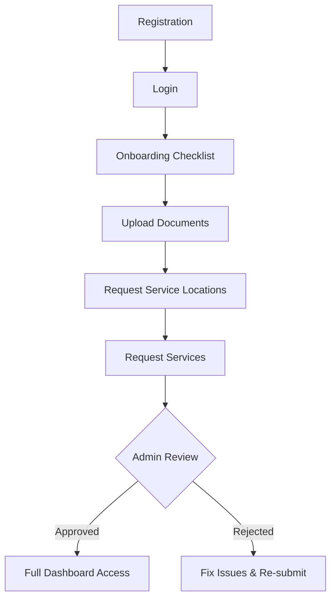

# TransRentals Vendor Flow Guide

Welcome to the TransRentals Vendor Partner Guide! This document explains the step-by-step process of joining our platform, from registration to managing your business dashboard.

---

## 🚀 Overview of the Vendor Journey

---

## 1. Registration 📝
To start your journey, visit the [Vendor Registration Page](https://transrentals.in/vendor/register).

### 📍 Step 1: Basic Information
Fill in your core business and personal contact details:
- **Business Name**: The registered name of your company.
- **Business Type**: Select from Sole Proprietor, Partnership, LLP, Pvt Ltd, etc.
- **Owner/Contact Name**: Full name of the primary contact person.
- **Email**: Official business email address.
- **Phone**: 10-digit mobile number for OTP/Contact.
- **Password**: Create a secure password (minimum 8 characters).
- **Confirm Password**: Re-type your password.

> [!NOTE]
> **[ SCREENSHOT PLACEHOLDER: Registration Step 1 Form ]**

### 📍 Step 2: Business Address & Tax Details
Provide your identity and location information:
- **GST Number (Optional)**: If you have a GST registration (e.g., 22AAAAA0000A1Z5).
- **PAN Number**: Your business or personal PAN card number.
- **Business Address**: Complete street address, building name, etc.
- **City**: Your base city of operations.
- **State**: Select your state from the list.
- **Pincode**: 6-digit postal code.

> [!NOTE]
> **[ SCREENSHOT PLACEHOLDER: Registration Step 2 Form ]**

---

## 2. Login 🔑
Once registered, [Login](https://transrentals.in/vendor/login) to access your dashboard.
- **Email**: Enter your registered business email.
- **Password**: Enter the password you created during registration.

> [!NOTE]
> **[ SCREENSHOT PLACEHOLDER: Vendor Login Screen ]**

---

## 3. The Onboarding Process 🛠️
After logging in for the first time, you will see your **Setup Progress** bar. You must complete these steps to get verified.

### 📍 Phase 1: Upload Documents 📄
Go to the [Documents Section](https://transrentals.in/vendor/documents). For each document, you can enter a **Document Number** and upload a file.

**Required Documents (Mandatory):**
- **GST Certificate**: Upload your official registration copy.
- **PAN Card**: Clear photo or PDF of your PAN.
- **Address Proof**: Utility bill, lease, or any valid proof.

**Optional Documents:**
- Business Registration Certificate.
- Cancelled Cheque.
- Owner's Aadhaar Card.

> [!NOTE]
> **[ SCREENSHOT PLACEHOLDER: Document Upload List & Modal ]**

### 📍 Phase 2: Request Service Locations 📍
Enable the cities where your fleet or service is available.

### 📍 Phase 3: Request Services 🚜
Select the categories you want to operate in (e.g., Bike, Car, Bus, Truck).

---

## 4. Verification ✅
Once all steps are done, your account goes to **UNDER REVIEW**.

- **Approved**: You get a checkmark and full dashboard access.
- **Rejected**: Admin will leave a **Rejection Reason**. You can "Re-upload" the specific document pointed out.

> [!NOTE]
> **[ SCREENSHOT PLACEHOLDER: Onboarding Under Review Status ]**

---

## 5. Your Business Dashboard 📊
The final stage! Access your earnings, bookings, and performance.

> [!IMPORTANT]
> **[ SCREENSHOT PLACEHOLDER: Fully Approved Dashboard with Live Stats ]**

---

## 🆘 Need Help?
If you face any issues, contact our support team via the **Support** section in your dashboard or email us at support@transrentals.in.
